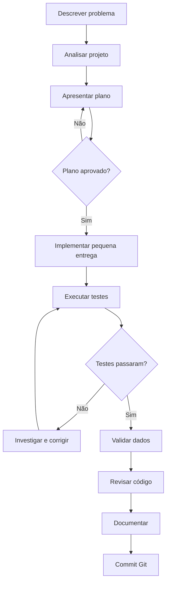

# 🧠 Vibe Coding para Engenharia de Dados

> Um guia prático para desenvolver, automatizar, testar e manter projetos de Engenharia de Dados utilizando Inteligência Artificial.


## 📑 Índice

- [1. Introdução](#1-introdução)
- [2. Ferramentas recomendadas](#2-ferramentas-recomendadas)
- [3. Como escrever bons prompts](#3-como-escrever-bons-prompts)
- [4. Biblioteca de prompts](#4-biblioteca-de-prompts-para-engenharia-de-dados)
  - [Desenvolvimento](#41-desenvolvimento)
  - [Debugging](#42-debugging)
  - [Qualidade de dados](#43-qualidade-de-dados)
  - [Arquitetura](#44-arquitetura)
  - [Documentação](#45-documentação)
- [5. Regras de ouro](#5-regras-de-ouro-do-vibe-coding-para-dados)
- [6. Workflow recomendado](#6-workflow-recomendado)
- [7. Arquivos essenciais](#7-arquivos-essenciais-para-projetos-com-ia)
- [8. Exemplos práticos](#8-exemplos-práticos)
- [9. Anti-patterns](#9-anti-patterns)
- [10. Checklist final](#10-checklist-final)
- [11. Referências oficiais](#11-referências-oficiais)

---

# 1. Introdução

## O que é Vibe Coding?

Vibe Coding é uma abordagem de desenvolvimento de software em que o desenvolvedor utiliza modelos de Inteligência Artificial para transformar instruções em linguagem natural em código executável.

Em vez de escrever manualmente cada função, classe ou consulta SQL, o desenvolvedor descreve o problema, fornece contexto, define restrições e orienta um agente de IA durante a implementação.

O processo normalmente envolve:

1. Descrever o que precisa ser desenvolvido.
2. Fornecer contexto sobre o projeto.
3. Solicitar uma implementação.
4. Executar e testar o código.
5. Analisar os resultados.
6. Corrigir problemas com auxílio da IA.
7. Revisar e integrar as alterações.

**Vibe Coding não significa deixar a IA desenvolver sem supervisão.** Em projetos profissionais, o engenheiro continua responsável pelas decisões arquiteturais, qualidade dos dados, segurança e confiabilidade do sistema.

## Como aplicar na Engenharia de Dados?

A Engenharia de Dados possui diversas atividades que podem ser aceleradas com IA:

| Atividade | Aplicação da IA |
|---|---|
| Ingestão | Criar leitores de CSV, JSON, TXT e APIs |
| Transformação | Desenvolver funções Python, Pandas e PySpark |
| Orquestração | Criar DAGs e workflows |
| Modelagem | Criar modelos dimensionais e modelos dbt |
| SQL | Desenvolver e otimizar consultas |
| Qualidade | Criar testes e regras de validação |
| Infraestrutura | Criar Dockerfiles e configurações |
| Documentação | Gerar READMEs, diagramas e documentação técnica |
| Debugging | Investigar logs e identificar possíveis causas de falhas |
| Monitoramento | Criar métricas, alertas e mecanismos de observabilidade |

## Benefícios

- **Velocidade:** reduz o tempo necessário para escrever código repetitivo.
- **Produtividade:** permite desenvolver diferentes partes de um projeto com maior agilidade.
- **Aprendizado:** facilita explorar bibliotecas, tecnologias e arquiteturas desconhecidas.
- **Documentação:** automatiza parte da criação de documentação técnica.
- **Prototipação:** permite testar ideias e arquiteturas rapidamente.
- **Debugging:** ajuda a interpretar erros e investigar possíveis causas.
- **Testes:** auxilia na criação de testes unitários e de integração.

## Limitações

A IA não possui conhecimento garantido sobre o estado real dos seus dados, infraestrutura ou ambiente de produção.

| A IA consegue ajudar com | Exige supervisão humana |
|---|---|
| Escrever código Python | Validar regras de negócio |
| Criar consultas SQL | Garantir resultados corretos |
| Sugerir arquiteturas | Avaliar decisões arquiteturais |
| Criar testes | Definir critérios de qualidade |
| Investigar logs | Confirmar a causa raiz |
| Sugerir otimizações | Medir ganhos reais |
| Documentar pipelines | Garantir que a documentação corresponda à implementação |
| Criar configurações | Validar permissões e segurança |

**Regra fundamental:** código que executa não significa código correto.

---

# 2. Ferramentas recomendadas

As ferramentas abaixo representam um ecossistema possível. Não é necessário utilizar todas simultaneamente.

## 2.1 IDEs e agentes de desenvolvimento

Ferramentas que permitem trabalhar diretamente com arquivos, repositórios e código.

| Ferramenta | Descrição | Documentação |
|---|---|---|
| Cursor | Editor de código com agentes de IA, edição de arquivos e contexto do projeto. | [cursor.com](https://cursor.com/) |
| Claude Code | Agente de desenvolvimento que trabalha com código, terminal e arquivos do projeto. | [Documentação](https://docs.claude.com/en/docs/claude-code/overview) |
| Windsurf | IDE com recursos de assistência e agentes para desenvolvimento. | [windsurf.com](https://windsurf.com/) |

## 2.2 Modelos de linguagem (LLMs)

Modelos que podem ser utilizados para gerar código, analisar problemas, explicar conceitos e revisar implementações.

| Ferramenta | Aplicação | Documentação |
|---|---|---|
| ChatGPT | Análise de código, SQL, arquitetura e resolução de problemas. | [openai.com](https://openai.com/chatgpt/) |
| Claude | Desenvolvimento, análise de código e tarefas com grandes contextos. | [claude.ai](https://claude.ai/) |
| Gemini | Desenvolvimento, análise e assistência multimodal. | [gemini.google.com](https://gemini.google.com/) |

A qualidade do resultado depende do modelo, contexto fornecido, complexidade da tarefa e capacidade de validar a implementação.

## 2.3 Desenvolvimento

| Ferramenta | Aplicação | Documentação |
|---|---|---|
| Python | Linguagem principal para pipelines e automações. | [python.org](https://www.python.org/) |
| Git | Controle de versão e histórico de alterações. | [git-scm.com](https://git-scm.com/doc) |
| GitHub | Repositórios, versionamento, Pull Requests e CI/CD. | [docs.github.com](https://docs.github.com/) |
| Docker | Padronização de ambientes e execução de serviços. | [docs.docker.com](https://docs.docker.com/) |
| uv | Gerenciamento de dependências e ambientes Python. | [docs.astral.sh/uv](https://docs.astral.sh/uv/) |
| pytest | Testes automatizados em Python. | [docs.pytest.org](https://docs.pytest.org/) |

## 2.4 Ferramentas de Engenharia de Dados

| Ferramenta | Aplicação | Documentação |
|---|---|---|
| DuckDB | Banco analítico local, processamento SQL e leitura de arquivos. | [duckdb.org](https://duckdb.org/docs/) |
| dbt | Transformações SQL, modelagem e testes de dados. | [docs.getdbt.com](https://docs.getdbt.com/) |
| Apache Airflow | Orquestração e agendamento de workflows. | [airflow.apache.org](https://airflow.apache.org/docs/) |
| Apache Spark | Processamento distribuído de grandes volumes de dados. | [spark.apache.org](https://spark.apache.org/docs/latest/) |
| Pandas | Manipulação e análise de dados em Python. | [pandas.pydata.org](https://pandas.pydata.org/docs/) |
| Polars | Processamento de dados tabulares com foco em performance. | [docs.pola.rs](https://docs.pola.rs/) |

## 2.5 Bancos de dados e plataformas

| Ferramenta | Aplicação | Documentação |
|---|---|---|
| PostgreSQL | Banco relacional e armazenamento de dados. | [postgresql.org](https://www.postgresql.org/docs/) |
| BigQuery | Data warehouse analítico na Google Cloud. | [cloud.google.com/bigquery](https://cloud.google.com/bigquery/docs) |
| Snowflake | Plataforma de dados e processamento analítico. | [docs.snowflake.com](https://docs.snowflake.com/) |
| Amazon Redshift | Data warehouse da AWS. | [docs.aws.amazon.com/redshift](https://docs.aws.amazon.com/redshift/) |

---

# 3. Como escrever bons prompts

A qualidade da resposta depende diretamente da qualidade do contexto fornecido.

Um prompt eficiente deve explicar não apenas o que você quer desenvolver, mas também como o projeto funciona e quais restrições precisam ser respeitadas.

## 3.1 Estrutura de um bom prompt

Utilize esta estrutura como referência:

| Elemento | O que informar |
|---|---|
| Contexto | Qual é o projeto e qual problema está sendo resolvido? |
| Objetivo | O que precisa ser desenvolvido? |
| Stack | Quais linguagens, bibliotecas e tecnologias utilizar? |
| Restrições | O que não pode ser alterado ou utilizado? |
| Entrada | Quais dados serão recebidos? |
| Saída | Qual resultado deve ser produzido? |
| Validação | Como saber se a implementação está correta? |

## 3.2 Template universal

Utilize o modelo abaixo como ponto de partida:

```text
CONTEXTO:
Estou desenvolvendo [descrição do projeto].

OBJETIVO:
Preciso implementar [funcionalidade].

STACK:
- Linguagem: [Python/SQL]
- Bibliotecas: [bibliotecas]
- Banco: [banco de dados]
- Infraestrutura: [local/cloud]

ENTRADA:
Os dados chegam através de [origem e formato].

SAÍDA ESPERADA:
O resultado deve ser [descrição].

RESTRIÇÕES:
- Não alterar a arquitetura existente.
- Reutilizar funções e componentes existentes.
- Não adicionar dependências desnecessárias.
- Seguir os padrões de código do projeto.
- Não inventar dados ou resultados.

VALIDAÇÃO:
- Criar testes automatizados.
- Validar casos de sucesso e erro.
- Verificar os resultados com dados de exemplo.

ANTES DE IMPLEMENTAR:
Analise os arquivos existentes e apresente um plano.
Não modifique nenhum arquivo antes de apresentar o plano.
```

## 3.3 Exemplos: prompt ruim vs. prompt melhorado

### Exemplo 1 — Pipeline

**Ruim:**

```text
Crie um pipeline de dados em Python.
```

**Melhorado:**

```text
Crie um pipeline ETL em Python que:

1. Leia arquivos CSV de uma pasta input/.
2. Valide os schemas.
3. Remova registros duplicados.
4. Normalize os nomes das colunas.
5. Trate valores nulos.
6. Salve os resultados em Parquet.

Requisitos:
- Utilizar Pandas e PyArrow.
- Separar ingestão, transformação e carga.
- Implementar logs.
- Tratar arquivos inválidos sem interromper
  o processamento dos demais.
- Criar testes com pytest.
- Não adicionar dependências além das necessárias.

Antes de implementar, analise a estrutura do projeto.
```

### Exemplo 2 — SQL

**Ruim:**

```text
Otimize essa query.
```

**Melhorado:**

```text
Analise a query SQL abaixo.

Objetivos:
- Identificar operações custosas.
- Avaliar JOINs e filtros.
- Verificar oportunidades de particionamento.
- Identificar leituras desnecessárias.
- Avaliar possíveis problemas de cardinalidade.

Não altere a lógica de negócio.

Entregue:
1. Diagnóstico.
2. Problemas encontrados.
3. Query otimizada.
4. Diferenças entre as versões.
5. Como validar que os resultados são equivalentes.

Considere que o banco utilizado é BigQuery.
```

### Exemplo 3 — Debugging

**Ruim:**

```text
Meu pipeline está dando erro. Corrija.
```

**Melhorado:**

```text
Investigue o erro abaixo no meu pipeline Python.

Contexto:
- Pipeline executado diariamente.
- Leitura de arquivos CSV.
- Transformação utilizando Pandas.
- Escrita em PostgreSQL.

Analise:
- Stack trace.
- Função responsável.
- Possíveis causas.
- Impactos em outras etapas.

Não faça alterações ainda.

Primeiro apresente:
1. Causa provável.
2. Evidências encontradas.
3. Alternativas de correção.
4. Riscos de cada alternativa.

Depois aguarde minha aprovação.
```

---

# 4. Biblioteca de prompts para Engenharia de Dados

Prompts prontos para copiar, adaptar e utilizar em projetos reais.

Substitua os campos entre colchetes pelas informações do seu projeto.

## 4.1 Desenvolvimento

### 1. Criar pipeline ETL/ELT

```text
Atue como um Engenheiro de Dados Sênior.

Preciso desenvolver um pipeline ETL utilizando Python.

Contexto:
- Origem: [API, CSV, banco ou outro].
- Destino: [PostgreSQL, BigQuery, Snowflake etc.].
- Frequência: [diária, horária, sob demanda].
- Volume estimado: [volume].

Requisitos:
1. Implementar extração dos dados.
2. Implementar transformações.
3. Implementar carregamento.
4. Criar logs estruturados.
5. Implementar tratamento de erros.
6. Permitir reprocessamento.
7. Evitar duplicidade na carga.
8. Implementar testes automatizados.

Organize o código em módulos com responsabilidades claras.

Considere idempotência, observabilidade e tratamento de falhas.

Antes de desenvolver, analise o projeto existente e apresente
um plano de implementação.
```

### 2. Criar leitor universal de CSV, JSON e TXT

```text
Crie um módulo Python responsável por ler arquivos
CSV, JSON e TXT.

O leitor deve:
- Identificar o formato pela extensão.
- Ler CSV com delimitadores configuráveis.
- Suportar JSON tradicional e JSON Lines.
- Permitir configurar encoding.
- Validar se o arquivo existe.
- Tratar arquivos vazios ou inválidos.
- Retornar uma estrutura de dados consistente.

Requisitos:
- Utilizar Pandas quando fizer sentido.
- Evitar duplicação de código.
- Implementar logs.
- Criar testes automatizados.
- Não utilizar Inteligência Artificial durante a execução.

Inclua exemplos de utilização e documente as limitações.
```

### 3. Desenvolver transformações com Pandas

```text
Desenvolva uma camada de transformação utilizando Pandas.

Dados de entrada:
[DESCREVA O DATASET]

Transformações necessárias:
- Padronizar nomes das colunas.
- Converter tipos de dados.
- Tratar valores nulos.
- Remover duplicidades conforme chave definida.
- Criar colunas derivadas.
- Validar registros inconsistentes.

Requisitos:
- Evitar operações desnecessárias.
- Preservar a rastreabilidade dos registros rejeitados.
- Não alterar os dados de entrada.
- Criar testes unitários.
- Documentar as regras de negócio.

Entregue o código e exemplos de entrada e saída.
```

### 4. Desenvolver transformações com PySpark

```text
Atue como especialista em Apache Spark.

Preciso implementar uma transformação utilizando PySpark.

Objetivo:
[DESCREVA A TRANSFORMAÇÃO]

Contexto:
- Versão do Spark: [VERSÃO]
- Origem: [ORIGEM]
- Volume: [VOLUME]
- Destino: [DESTINO]

Analise:
- Estratégia de transformação.
- Uso de DataFrames e funções nativas.
- Possíveis shuffles.
- Particionamento.
- Uso de cache.
- Risco de skew.
- Consumo de memória.

Priorize funções nativas do Spark em vez de UDFs
quando houver alternativa adequada.

Inclua testes e explique as decisões de performance.
```

### 5. Criar modelos dbt

```text
Desenvolva modelos dbt para o seguinte cenário:

Contexto:
[DESCREVA AS TABELAS DE ORIGEM E REGRAS DE NEGÓCIO]

Objetivo:
Criar modelos organizados em:
- Staging.
- Intermediate.
- Marts.

Requisitos:
- Seguir boas práticas de modelagem.
- Utilizar ref() e source() corretamente.
- Criar schema.yml.
- Implementar testes de unique, not_null e relationships
  quando aplicáveis.
- Documentar tabelas e colunas.
- Utilizar incremental materialization quando justificado.
- Evitar SELECT * nos modelos finais.

Não invente colunas ou regras de negócio.

Antes de implementar, apresente a estrutura proposta.
```

### 6. Gerar consultas SQL complexas

```text
Atue como um Engenheiro de Dados especialista em SQL.

Preciso desenvolver uma consulta para:

[DESCREVA O PROBLEMA DE NEGÓCIO]

Banco utilizado: [BIGQUERY / SNOWFLAKE / POSTGRESQL]

Estrutura das tabelas:
[DESCREVA TABELAS, COLUNAS E RELACIONAMENTOS]

Requisitos:
- Utilizar CTEs quando melhorarem a legibilidade.
- Evitar JOINs desnecessários.
- Tratar valores nulos explicitamente.
- Evitar duplicidades.
- Preservar a granularidade esperada.
- Considerar performance e custo.

Explique a lógica da consulta e apresente
um exemplo de resultado esperado.

Não invente informações sobre os dados.
```

### 7. Criar API para disponibilizar dados

```text
Desenvolva uma API REST utilizando FastAPI.

Objetivo:
Disponibilizar os dados da tabela [NOME DA TABELA].

Endpoints necessários:
- GET /data
- GET /data/{id}
- GET /health

Requisitos:
- Implementar paginação.
- Validar parâmetros.
- Utilizar schemas Pydantic.
- Implementar tratamento de erros.
- Separar rotas, serviços e acesso aos dados.
- Configurar variáveis de ambiente.
- Criar testes automatizados.
- Documentar os endpoints.

Não exponha credenciais ou informações sensíveis.

Utilize uma arquitetura simples e adequada ao tamanho do projeto.
```

## 4.2 Debugging

### 8. Investigar erros em pipelines

```text
Atue como um Engenheiro de Dados Sênior especializado
em troubleshooting.

Investigue o seguinte erro:

[COLE O ERRO OU STACK TRACE]

Contexto:
[DESCREVA O PIPELINE]

Analise:
1. Local provável da falha.
2. Causa raiz provável.
3. Evidências disponíveis.
4. Impactos nas etapas seguintes.
5. Possíveis soluções.
6. Como evitar recorrência.

Não assuma que a primeira hipótese está correta.

Se faltarem informações, solicite os dados necessários.

Não altere o código antes de apresentar o diagnóstico.
```

### 9. Otimizar queries SQL

```text
Analise e otimize a seguinte query:

[COLE A QUERY]

Banco: [BANCO]
Volume estimado: [VOLUME]
Tempo atual: [TEMPO]
Custo atual: [CUSTO, SE DISPONÍVEL]

Investigue:
- Full table scans.
- JOINs.
- CTEs.
- Subqueries.
- Filtros.
- Particionamento.
- Clustering.
- Cardinalidade.

Entregue:
1. Diagnóstico.
2. Principais gargalos.
3. Query otimizada.
4. Comparação entre as versões.
5. Plano de validação.

Não sacrifique a equivalência dos resultados por performance.
Não invente métricas de execução.
```

### 10. Identificar gargalos de performance

```text
Analise o desempenho deste pipeline de dados.

Código:
[COLE O CÓDIGO]

Métricas disponíveis:
[COLE LOGS, TEMPOS, MEMÓRIA E VOLUMES]

Identifique:
- Etapas mais lentas.
- Operações redundantes.
- Gargalos de CPU.
- Gargalos de memória.
- Problemas de I/O.
- Possíveis gargalos de paralelismo.

Priorize otimizações com impacto mensurável.

Para cada sugestão, informe:
- Problema.
- Causa provável.
- Solução.
- Impacto esperado.
- Como medir o resultado.

Não invente benchmarks.
```

### 11. Corrigir problemas de memória

```text
Investigue o consumo excessivo de memória neste processo Python.

Código:
[COLE O CÓDIGO]

Contexto:
- Volume de dados: [VOLUME]
- Memória disponível: [RAM]
- Ambiente: [AMBIENTE]

Avalie:
- Carregamento integral dos dados.
- Cópias desnecessárias de DataFrames.
- Tipos de dados inadequados.
- Objetos mantidos em memória.
- Operações de concatenação.
- Possibilidade de processamento em chunks.

Proponha uma solução que preserve os resultados.

Inclua uma forma de medir o consumo de memória
antes e depois da alteração.
```

### 12. Analisar logs de execução

```text
Analise os logs abaixo de uma execução de pipeline.

[COLE OS LOGS]

Identifique:
- Erros.
- Warnings.
- Etapas executadas.
- Tempo de execução.
- Possíveis falhas silenciosas.
- Inconsistências na sequência de execução.

Organize o diagnóstico cronologicamente.

Diferencie:
- Problemas confirmados.
- Hipóteses.
- Informações insuficientes.

Finalize com uma lista priorizada de ações corretivas.
```

## 4.3 Qualidade de dados

### 13. Criar testes automatizados

```text
Crie testes automatizados para o pipeline abaixo:

[CÓDIGO OU DESCRIÇÃO]

Utilize pytest.

Cubra:
- Caminho de execução normal.
- Arquivos vazios.
- Valores nulos.
- Dados duplicados.
- Tipos inválidos.
- Arquivos inexistentes.
- Erros de conexão.
- Falhas durante a transformação.

Utilize fixtures e dados controlados.

Não dependa de serviços externos nos testes unitários.

Inclua testes de integração separados quando necessário.
```

### 14. Identificar duplicidades

```text
Analise o dataset abaixo:

[DESCREVA O DATASET]

Chaves candidatas:
[COLUNAS]

Identifique:
- Duplicidades exatas.
- Duplicidades por chave de negócio.
- Registros com diferenças entre atributos.
- Possíveis problemas de granularidade.

Proponha uma estratégia de deduplicação.

Não remova registros automaticamente.

Explique quais registros seriam mantidos e por quê.
Crie uma consulta SQL para identificar as duplicidades.
```

### 15. Validar schemas

```text
Implemente validação de schema para os dados recebidos.

Schema esperado:
[DESCREVA COLUNAS E TIPOS]

Valide:
- Colunas obrigatórias.
- Tipos de dados.
- Colunas inesperadas.
- Valores nulos.
- Formatos inválidos.
- Campos obrigatórios.

O processo deve identificar incompatibilidades
antes de iniciar as transformações.

Crie testes para schemas válidos e inválidos.

Retorne erros descritivos, identificando a coluna
e o problema encontrado.
```

### 16. Implementar regras de qualidade

```text
Implemente uma camada de Data Quality.

Regras:
[LISTE AS REGRAS DE NEGÓCIO]

Exemplos:
- IDs não podem ser nulos.
- Datas não podem estar no futuro.
- Valores financeiros devem respeitar limites definidos.
- Chaves de negócio devem ser únicas.
- Relacionamentos devem ser válidos.

Requisitos:
- Executar validações automaticamente.
- Gerar relatório de qualidade.
- Identificar registros inválidos.
- Separar erros críticos de warnings.
- Registrar resultados da execução.

Não descarte dados inválidos sem rastreabilidade.
```

### 17. Detectar dados inconsistentes

```text
Analise os dados abaixo e procure inconsistências:

[DESCREVA OU FORNEÇA OS DADOS]

Investigue:
- Valores fora do padrão.
- Datas inconsistentes.
- Categorias inesperadas.
- Divergências entre campos relacionados.
- Alterações abruptas de distribuição.
- Possíveis problemas de ingestão.

Diferencie anomalias estatísticas de erros confirmados.

Apresente as evidências e sugira regras automatizadas
para detectar os mesmos problemas em futuras execuções.
```

## 4.4 Arquitetura

### 18. Desenhar arquitetura Lakehouse

```text
Atue como Arquiteto de Dados.

Preciso desenhar uma arquitetura Lakehouse para:

[CENÁRIO DO PROJETO]

Contexto:
- Volume: [VOLUME]
- Fontes: [FONTES]
- Frequência: [FREQUÊNCIA]
- Usuários: [USUÁRIOS]
- Orçamento: [ORÇAMENTO]
- Ambiente: [CLOUD OU LOCAL]

Avalie uma arquitetura com:
- Ingestion.
- Bronze.
- Silver.
- Gold.
- Storage.
- Processing.
- Orchestration.
- Data Quality.
- Observability.

Explique as tecnologias recomendadas e suas alternativas.

Considere custo, escalabilidade, manutenção e complexidade.

Gere também um diagrama Mermaid.
```

### 19. Criar pipelines incrementais

```text
Projete uma estratégia de ingestão incremental.

Contexto:
- Origem: [ORIGEM]
- Destino: [DESTINO]
- Coluna de controle: [UPDATED_AT / ID]
- Frequência: [FREQUÊNCIA]

Considere:
- Watermark.
- CDC, quando aplicável.
- Upsert ou MERGE.
- Idempotência.
- Reprocessamento.
- Late arriving data.
- Duplicidades.
- Falhas durante a execução.

Explique como garantir que os dados não sejam
perdidos ou duplicados.

Apresente uma implementação de referência em [TECNOLOGIA].
```

### 20. Implementar particionamento

```text
Analise a estratégia de particionamento para a tabela:

[TABELA E DESCRIÇÃO]

Contexto:
- Banco: [BANCO]
- Volume: [VOLUME]
- Consultas mais frequentes: [CONSULTAS]
- Colunas disponíveis: [COLUNAS]

Avalie:
- Particionamento por data.
- Particionamento por chave.
- Clustering.
- Distribuição dos dados.
- Impacto nas consultas.
- Custo de armazenamento e processamento.

Recomende uma estratégia e justifique tecnicamente.

Não recomende particionamento sem demonstrar
qual problema ele pretende resolver.
```

### 21. Planejar estratégias de armazenamento

```text
Avalie estratégias de armazenamento para este projeto:

[CENÁRIO]

Compare:
- CSV.
- JSON.
- JSONL.
- Parquet.
- Avro.
- ORC.

Considere:
- Compressão.
- Performance de leitura.
- Performance de escrita.
- Evolução de schema.
- Compatibilidade.
- Custo.
- Volume de dados.

Indique o formato mais adequado para cada camada
do pipeline e justifique a escolha.
```

### 22. Avaliar custos de infraestrutura

```text
Atue como especialista em FinOps para Engenharia de Dados.

Analise a infraestrutura abaixo:

[DESCREVA A INFRAESTRUTURA]

Considere:
- Volume processado.
- Frequência dos pipelines.
- Armazenamento.
- Compute.
- Transferência de dados.
- Retenção.
- Consultas analíticas.

Identifique oportunidades de redução de custos.

Para cada recomendação, apresente:
- Recurso afetado.
- Problema identificado.
- Mudança sugerida.
- Possíveis impactos.
- Dados necessários para calcular a economia.

Não invente preços ou métricas.
Utilize apenas valores fornecidos ou documentados.
```

## 4.5 Documentação

### 23. Gerar documentação técnica

```text
Analise o código deste projeto e gere documentação técnica.

Inclua:
- Objetivo do projeto.
- Arquitetura.
- Tecnologias.
- Fluxo de execução.
- Estrutura de diretórios.
- Entradas e saídas.
- Dependências.
- Configurações.
- Tratamento de erros.
- Testes.

Não documente funcionalidades que não existem.

Identifique também pontos que precisam de documentação adicional.
```

### 24. Criar diagramas Mermaid

```text
Analise o pipeline descrito abaixo:

[DESCREVA O PIPELINE]

Crie diagramas Mermaid para representar:

1. Arquitetura geral.
2. Fluxo de processamento.
3. Dependências entre etapas.
4. Fluxo de tratamento de erros.

Utilize nomes claros e mantenha os diagramas legíveis.

Não adicione componentes que não foram mencionados.

Entregue somente os blocos Mermaid e uma breve explicação.
```

### 25. Documentar tabelas e colunas

```text
Gere um catálogo de documentação para as tabelas abaixo:

[SCHEMAS OU DDL]

Para cada tabela, documente:
- Nome.
- Descrição.
- Granularidade.
- Chave primária.
- Chaves estrangeiras.
- Colunas.
- Tipos.
- Regras de negócio.
- Origem dos dados.
- Frequência de atualização.

Identifique campos cuja finalidade não pode ser inferida.

Não invente descrições de negócio.
```

### 26. Criar README para projetos

```text
Analise o repositório e crie um README.md profissional.

Inclua:
- Descrição do projeto.
- Objetivo.
- Arquitetura.
- Stack tecnológica.
- Pré-requisitos.
- Instalação.
- Configuração.
- Como executar.
- Estrutura de diretórios.
- Exemplos de entrada e saída.
- Testes.
- Troubleshooting.

Utilize Markdown, tabelas e diagramas Mermaid quando apropriado.

Todos os comandos devem corresponder à implementação existente.
Não invente funcionalidades ou dependências.
```

### 27. Documentar pipelines

```text
Documente o pipeline abaixo:

[CÓDIGO OU ESTRUTURA]

Explique:
- Origem dos dados.
- Etapas de ingestão.
- Transformações.
- Regras de negócio.
- Destino.
- Dependências.
- Frequência.
- Tratamento de falhas.
- Estratégia de reprocessamento.
- Monitoramento.

Gere também um diagrama Mermaid.

A documentação deve permitir que outro Engenheiro de Dados
entenda e mantenha o pipeline sem precisar perguntar
ao desenvolvedor original.
```

---

# 5. Regras de ouro do Vibe Coding para Dados

Utilizar IA para desenvolver código exige disciplina técnica. Em Engenharia de Dados, erros aparentemente pequenos podem produzir resultados incorretos em milhões de registros.

## 5.1 Nunca confie cegamente no código gerado

A IA pode produzir código sintaticamente correto, mas com lógica de negócio incorreta.

Revise:
- JOINs.
- Agregações.
- Filtros.
- Tratamento de nulos.
- Conversões de tipos.
- Regras de deduplicação.
- Estratégias incrementais.

## 5.2 Sempre valide com dados

Não considere uma implementação concluída apenas porque executou sem erros.

Compare:
- Quantidade de registros.
- Quantidade de registros distintos.
- Valores agregados.
- Distribuição de dados.
- Registros rejeitados.
- Resultados antes e depois das transformações.

## 5.3 Nunca exponha informações sensíveis

Não envie para ferramentas externas:
- Senhas.
- Tokens.
- Chaves privadas.
- Credenciais de cloud.
- Dados pessoais identificáveis.
- Dados confidenciais de clientes.

Utilize dados sintéticos ou anonimizados quando possível.

Considere também as políticas de privacidade, retenção e uso de dados da ferramenta e da organização.

## 5.4 Crie testes antes de produção

Todo pipeline relevante deve possuir testes.

Priorize:
- Testes unitários.
- Testes de integração.
- Testes de schema.
- Testes de qualidade.
- Testes de regressão.
- Testes de idempotência.

## 5.5 Utilize Git constantemente

Trabalhe com alterações pequenas e rastreáveis.

```bash
git status
git diff

git add .
git commit -m "feat: implement data ingestion"
```

Evite acumular muitas alterações geradas por IA antes de revisar o histórico.

## 5.6 Não altere a arquitetura sem necessidade

Se o projeto utiliza Pandas, não migre tudo para Spark apenas porque o agente sugeriu.

Toda mudança arquitetural deve considerar:
- Volume.
- Complexidade.
- Custos.
- Manutenção.
- Performance.
- Conhecimento da equipe.

## 5.7 Peça explicações sobre decisões técnicas

Não aceite soluções que você não consegue explicar.

Pergunte:

```text
Explique as decisões técnicas dessa implementação.

Quero entender:
- Por que essa abordagem foi escolhida?
- Quais alternativas existem?
- Quais são as limitações?
- Quais problemas podem ocorrer em produção?
- Em quais cenários essa implementação não seria adequada?
```

## 5.8 Trabalhe em pequenas entregas

Divida grandes tarefas em funcionalidades independentes.

Em vez de solicitar um pipeline inteiro, desenvolva:

1. Leitor de arquivos.
2. Validação de schema.
3. Transformação.
4. Persistência.
5. Testes.
6. Logs.
7. Documentação.

## 5.9 Revise SQL e transformações

Atenção especial para:
- JOINs que multiplicam registros.
- Agregações com granularidade incorreta.
- Filtros que eliminam registros válidos.
- Timezones.
- Datas e timestamps.
- Precisão numérica.
- NULL versus valores vazios.

## 5.10 Meça performance

Não aceite afirmações como "essa versão é 10 vezes mais rápida" sem benchmark.

Compare:
- Tempo de execução.
- CPU.
- Memória.
- I/O.
- Volume processado.
- Custo computacional.

Sempre que possível, compare as versões utilizando o mesmo conjunto de dados e condições de execução.

---

# 6. Workflow recomendado

Um dos maiores erros ao utilizar agentes de IA é solicitar uma implementação completa sem estabelecer etapas de controle.

O workflow abaixo reduz alterações desnecessárias e facilita identificar problemas.

## 6.1 Fluxo de desenvolvimento



## 6.2 Passo a passo

| Etapa | Ação | Objetivo |
|---|---|---|
| 1 | Descrever o problema | Definir o que precisa ser resolvido |
| 2 | Analisar o projeto | Entender a arquitetura existente |
| 3 | Definir o plano | Estabelecer etapas e arquivos afetados |
| 4 | Aprovar o plano | Evitar alterações indesejadas |
| 5 | Implementar | Desenvolver uma pequena funcionalidade |
| 6 | Executar testes | Identificar erros |
| 7 | Validar dados | Garantir resultados corretos |
| 8 | Revisar código | Avaliar qualidade e segurança |
| 9 | Documentar | Registrar funcionamento e decisões |
| 10 | Fazer commit | Versionar a implementação |

## 6.3 Exemplo prático: pipeline Python

Imagine um projeto que precisa receber arquivos CSV, transformar os dados e disponibilizar o resultado em Parquet.

Estrutura inicial:

```text
data-pipeline/
├── data/
│   ├── input/
│   └── output/
├── src/
├── tests/
├── README.md
└── pyproject.toml
```

### Etapa 1 — Analisar o projeto

Prompt:

```text
Analise a estrutura atual deste projeto Python.

Objetivo:
Criar um pipeline que leia CSV, transforme os dados
e gere arquivos Parquet.

Não modifique arquivos.

Identifique:
- Estrutura existente.
- Dependências.
- Código reutilizável.
- Pontos de entrada.
- Arquivos que precisarão ser criados.

Apresente um plano de implementação.
```

### Etapa 2 — Criar o leitor

Prompt:

```text
Implemente um módulo responsável por ler arquivos CSV
localizados em data/input/.

Requisitos:
- Utilizar Pandas.
- Permitir múltiplos arquivos.
- Validar existência dos arquivos.
- Tratar arquivos vazios.
- Gerar logs.
- Retornar DataFrames.

Não implemente transformações nesta etapa.

Crie testes unitários.
```

### Etapa 3 — Criar as transformações

Prompt:

```text
Implemente a camada de transformação.

Requisitos:
- Padronizar nomes das colunas.
- Remover duplicidades conforme chave definida.
- Tratar valores nulos.
- Converter tipos de dados.
- Registrar quantidade de registros processados.

Mantenha o leitor independente das transformações.

Crie testes para cada regra.
```

### Etapa 4 — Implementar persistência

Prompt:

```text
Implemente a camada de persistência.

Salve os DataFrames transformados em Parquet
na pasta data/output/.

Requisitos:
- Utilizar PyArrow.
- Criar diretórios automaticamente.
- Não sobrescrever dados sem uma estratégia explícita.
- Tratar erros de escrita.
- Registrar quantidade de registros gravados.

Crie testes utilizando diretórios temporários.
```

### Etapa 5 — Integrar o pipeline

Prompt:

```text
Agora integre os módulos existentes.

Fluxo esperado:

CSV → Reader → Validation → Transformation → Parquet

Requisitos:
- Criar um ponto de entrada.
- Executar o fluxo completo.
- Implementar logs por etapa.
- Retornar status de execução.
- Tratar exceções.
- Permitir execução via terminal.

Não altere os módulos que já estão funcionando
sem necessidade.
```

### Etapa 6 — Validar o resultado

Prompt:

```text
Revise o pipeline completo.

Execute os testes disponíveis e verifique:

- Integridade dos dados.
- Quantidade de registros.
- Duplicidades.
- Tipos de dados.
- Arquivos gerados.
- Tratamento de erros.

Compare os resultados com os dados de entrada.

Identifique problemas e apresente evidências.

Não declare o projeto concluído se houver testes
não executados ou resultados não validados.
```

---

# 7. Arquivos essenciais para projetos com IA

Agentes de IA precisam entender como o projeto está organizado, quais tecnologias são utilizadas e quais regras devem respeitar.

Arquivos de instrução reduzem a necessidade de repetir o mesmo contexto em todas as conversas.

## 7.1 AGENTS.md

Arquivo de instruções gerais do projeto para agentes de desenvolvimento compatíveis.

Normalmente fica na raiz do repositório.

Exemplo:

```text
data-pipeline/
├── AGENTS.md
├── README.md
├── pyproject.toml
├── src/
└── tests/
```

Exemplo de conteúdo:

```markdown
# Project Instructions

## Project
Projeto de Engenharia de Dados utilizando Python.

## Architecture
- Separar ingestão, transformação e persistência.
- Manter cada responsabilidade em seu próprio módulo.
- Evitar dependências desnecessárias entre camadas.

## Code Standards
- Utilizar Python 3.11+.
- Seguir PEP 8.
- Utilizar type hints.
- Criar docstrings para funções públicas.

## Data Engineering
- Preservar a granularidade dos dados.
- Não remover registros sem regra explícita.
- Validar schemas antes das transformações.
- Garantir idempotência quando aplicável.

## Testing
- Utilizar pytest.
- Criar testes para novas funcionalidades.
- Não considerar testes como aprovados sem executá-los.

## Safety
- Nunca inserir credenciais no código.
- Não modificar arquivos de dados reais sem autorização.
- Não executar operações destrutivas sem confirmação.

## Workflow
- Analisar antes de implementar.
- Apresentar plano de alterações.
- Trabalhar em pequenas entregas.
- Executar testes após alterações.
- Atualizar documentação quando necessário.
```

**Importante:** o suporte e a precedência de arquivos de instrução variam entre agentes. Verifique a documentação da ferramenta utilizada.

## 7.2 .cursor/rules/

Permite definir instruções específicas para o Cursor.

Exemplo:

```text
.cursor/
└── rules/
    ├── general.mdc
    ├── python.mdc
    ├── sql.mdc
    └── data-quality.mdc
```

Exemplo de `python.mdc`:

```markdown
---
description: Python development standards for data pipelines
globs: ["src/**/*.py", "tests/**/*.py"]
alwaysApply: false
---

# Python Rules

- Use type hints.
- Prefer small and reusable functions.
- Separate business logic from I/O.
- Use structured logging.
- Handle exceptions explicitly.
- Avoid unnecessary dependencies.
- Write pytest tests for new functionality.
- Never hardcode credentials.
```

Exemplo de `sql.mdc`:

```markdown
---
description: SQL standards for data engineering
globs: ["**/*.sql"]
alwaysApply: false
---

# SQL Rules

- Use explicit column selection.
- Avoid SELECT * in production models.
- Use clear aliases.
- Preserve data grain.
- Validate JOIN cardinality.
- Handle NULL values explicitly.
- Avoid unnecessary subqueries.
- Document complex business rules.
```

O Cursor utiliza arquivos `.mdc` para regras de projeto. Um arquivo Markdown comum dentro dessa pasta não substitui esse formato.

## 7.3 README.md

É a documentação principal do projeto.

Deve responder:

- O que o projeto faz?
- Quais tecnologias utiliza?
- Como instalar?
- Como configurar?
- Como executar?
- Como testar?
- Qual é a arquitetura?

O README também serve como contexto inicial para os agentes.

## 7.4 pyproject.toml

Arquivo de configuração e metadados do projeto Python.

Pode centralizar dependências, configurações de ferramentas e informações do pacote.

Exemplo:

```toml
[project]
name = "data-pipeline"
version = "0.1.0"
requires-python = ">=3.11"
dependencies = [
    "pandas",
    "pyarrow",
]

[project.optional-dependencies]
dev = [
    "pytest",
    "ruff",
]

[tool.pytest.ini_options]
testpaths = ["tests"]

[tool.ruff]
line-length = 88
target-version = "py311"
```

## 7.5 .env.example

Documenta as variáveis de ambiente necessárias para executar o projeto.

Exemplo:

```env
APP_ENV=development

DATABASE_HOST=localhost
DATABASE_PORT=5432
DATABASE_NAME=datawarehouse
DATABASE_USER=admin
DATABASE_PASSWORD=

INPUT_DIR=./data/input
OUTPUT_DIR=./data/output

LOG_LEVEL=INFO
```

O arquivo deve conter apenas exemplos e valores não sensíveis.

Nunca versione o `.env` real.

Inclua no `.gitignore`:

```gitignore
.env
.env.*
!.env.example

__pycache__/
.pytest_cache/
.venv/
```

## 7.6 tests/

Diretório responsável pelos testes automatizados.

Estrutura sugerida:

```text
tests/
├── unit/
│   ├── test_reader.py
│   ├── test_transform.py
│   └── test_writer.py
│
├── integration/
│   └── test_pipeline.py
│
└── fixtures/
    └── sample.csv
```

Exemplo:

```python
def test_remove_duplicates():
    import pandas as pd

    from src.transform import remove_duplicates

    df = pd.DataFrame({
        "id": [1, 2, 2, 3],
        "name": ["Ana", "João", "João", "Maria"],
    })

    result = remove_duplicates(df, subset=["id"])

    assert len(result) == 3
    assert result["id"].is_unique
```

## 7.7 docker-compose.yml

Permite definir e executar serviços relacionados ao projeto utilizando Docker Compose.

Exemplo:

```yaml
services:
  postgres:
    image: postgres:16
    container_name: data-postgres
    environment:
      POSTGRES_DB: warehouse
      POSTGRES_USER: admin
      POSTGRES_PASSWORD: local_dev_password
    ports:
      - "5432:5432"
    volumes:
      - postgres_data:/var/lib/postgresql/data

volumes:
  postgres_data:
```

Utilize credenciais exclusivamente locais para desenvolvimento. Não reutilize senhas de produção.

## 7.8 Estrutura recomendada

Uma organização possível para projetos Python de Engenharia de Dados:

```text
data-pipeline/
│
├── .cursor/
│   └── rules/
│       ├── general.mdc
│       ├── python.mdc
│       └── sql.mdc
│
├── data/
│   ├── input/
│   ├── processed/
│   └── output/
│
├── src/
│   ├── ingestion/
│   │   └── reader.py
│   │
│   ├── transformation/
│   │   └── transform.py
│   │
│   ├── storage/
│   │   └── writer.py
│   │
│   ├── quality/
│   │   └── validation.py
│   │
│   └── main.py
│
├── tests/
│   ├── unit/
│   └── integration/
│
├── .env.example
├── .gitignore
├── AGENTS.md
├── README.md
├── pyproject.toml
└── docker-compose.yml
```

Essa estrutura é uma referência, não uma arquitetura obrigatória. Projetos menores podem utilizar menos diretórios.

---

# 8. Exemplos práticos

Cinco cenários de Engenharia de Dados em que o uso de IA pode acelerar o desenvolvimento.

## Exemplo 1 — Ingestão automática de arquivos

**Problema**

Uma equipe recebe diariamente arquivos CSV e JSON de diferentes fontes. Cada arquivo possui pequenas diferenças de estrutura.

**Prompt utilizado**

```text
Desenvolva um módulo Python de ingestão de arquivos.

Ele deve:
- Ler CSV e JSON.
- Detectar arquivos inválidos.
- Validar schemas.
- Normalizar nomes de colunas.
- Registrar logs.
- Gerar um relatório de ingestão.

A entrada será uma pasta com múltiplos arquivos.

Não utilize serviços externos.

Crie testes com diferentes formatos e estruturas.
```

**Resultado esperado**

Um módulo reutilizável capaz de receber diferentes arquivos e produzir dados estruturados, acompanhados de logs e informações de validação.

**Como validar**

- Testar arquivos CSV válidos.
- Testar JSON inválido.
- Testar arquivos vazios.
- Comparar quantidade de registros.
- Verificar se schemas incompatíveis são identificados.

## Exemplo 2 — Migração de SQL entre plataformas

**Problema**

Migrar consultas SQL de PostgreSQL para BigQuery.

**Prompt utilizado**

```text
Converta a consulta PostgreSQL abaixo para BigQuery.

[QUERY]

Identifique incompatibilidades relacionadas a:
- Tipos de dados.
- Funções de data.
- JSON.
- Arrays.
- Window functions.
- Tratamento de NULL.
- Sintaxe de JOIN.

Explique cada alteração.

Preserve a lógica de negócio.

Não considere a migração concluída apenas porque
a consulta executa.
```

**Resultado esperado**

Uma consulta adaptada à sintaxe do BigQuery, acompanhada de explicações sobre as diferenças entre os bancos.

**Como validar**

- Executar as duas consultas sobre conjuntos equivalentes.
- Comparar quantidade de registros.
- Comparar agregações.
- Comparar resultados por chave.
- Avaliar diferenças de precisão e timezone.

## Exemplo 3 — Criação de modelos dbt

**Problema**

Uma tabela transacional precisa ser organizada em modelos staging e marts.

**Prompt utilizado**

```text
Analise a estrutura da tabela transactions.

Crie:
- stg_transactions.sql
- int_transactions.sql
- fct_transactions.sql
- schema.yml

Considere:
- Padronização de colunas.
- Regras de negócio.
- Granularidade transacional.
- Testes de unicidade.
- Campos obrigatórios.
- Documentação.

Utilize a estrutura existente do projeto dbt.

Não invente regras de negócio.
```

**Resultado esperado**

Modelos organizados e documentados, com dependências explícitas e testes configurados.

**Como validar**

```bash
dbt parse
dbt compile
dbt test
```

Execute também os modelos no ambiente apropriado e compare os resultados com a origem.

## Exemplo 4 — Otimização de pipeline PySpark

**Problema**

Um job demora muito para processar uma grande quantidade de registros.

**Prompt utilizado**

```text
Analise o código PySpark abaixo.

[CÓDIGO]

O job processa aproximadamente [VOLUME]
e demora [TEMPO].

Investigue:
- Shuffles.
- Skew.
- Joins.
- Repartition.
- Cache.
- UDFs.
- Leitura e escrita.
- Uso de memória.

Apresente as otimizações por prioridade.

Não altere a lógica de negócio.

Explique como comparar o desempenho antes e depois.
```

**Resultado esperado**

Diagnóstico dos gargalos e sugestões de otimização acompanhadas de uma implementação que preserve os resultados.

**Como validar**

- Comparar planos de execução.
- Comparar tempo de processamento.
- Medir recursos utilizados.
- Verificar quantidade de registros.
- Comparar resultados por chave.

## Exemplo 5 — Implementação de Data Quality

**Problema**

Um pipeline recebe dados inconsistentes e não identifica problemas antes da carga final.

**Prompt utilizado**

```text
Implemente uma camada de Data Quality em Python.

Regras:
- IDs não podem ser nulos.
- Não pode haver duplicidade de chave primária.
- Datas devem respeitar o intervalo definido.
- Valores financeiros não podem ser inválidos.
- Campos obrigatórios devem estar presentes.

Gere:
- Quantidade de registros válidos.
- Quantidade de registros inválidos.
- Lista de regras violadas.
- Relatório de execução.

Não descarte dados inválidos.
Separe registros válidos e rejeitados.
Crie testes automatizados.
```

**Resultado esperado**

Uma camada de validação que identifica inconsistências antes de disponibilizar os dados.

**Como validar**

- Criar datasets válidos e inválidos.
- Testar cada regra individualmente.
- Comparar quantidade de registros.
- Verificar se registros rejeitados são preservados.
- Validar o relatório final.

---

# 9. Anti-patterns

Erros comuns ao utilizar agentes de IA em projetos de dados.

| Anti-pattern | Problema | Abordagem correta |
|---|---|---|
| Criar o projeto inteiro em um único prompt | Dificulta revisão e aumenta inconsistências. | Dividir em entregas pequenas. |
| Aceitar código sem entender | Pode introduzir erros silenciosos. | Solicitar explicações e revisar. |
| Ignorar testes | Problemas chegam à produção. | Criar testes desde o início. |
| Misturar responsabilidades | Código difícil de manter. | Separar ingestão, transformação e persistência. |
| Permitir alterações sem revisão | O agente pode modificar arquivos desnecessários. | Revisar diffs e aprovar mudanças. |
| Inventar dados ou resultados | Produz conclusões falsas. | Trabalhar com dados reais ou controlados. |
| Criar abstrações desnecessárias | Aumenta complexidade sem benefício. | Preferir soluções simples. |
| Ignorar custos | Pode gerar infraestrutura cara. | Avaliar custo antes de implementar. |
| Ignorar idempotência | Reexecuções podem duplicar dados. | Implementar estratégias de carga seguras. |
| Confiar apenas na execução | Código executável pode produzir dados errados. | Comparar resultados com critérios independentes. |
| Colocar credenciais nos prompts | Risco de exposição de informações. | Utilizar variáveis de ambiente e dados anonimizados. |
| Fazer refatorações fora do escopo | Aumenta o risco de regressões. | Limitar o escopo de cada tarefa. |

## Um princípio importante

A IA deve reduzir o trabalho operacional do engenheiro, não substituir o raciocínio necessário para construir sistemas confiáveis.

O objetivo não é gerar mais código.

O objetivo é entregar soluções corretas, testáveis, eficientes e fáceis de manter em menos tempo.

---

# 10. Checklist final

Utilize este checklist antes de considerar concluído um projeto desenvolvido com Vibe Coding.

## Arquitetura

- [ ] O objetivo do projeto está documentado.
- [ ] A arquitetura está definida.
- [ ] As responsabilidades estão separadas.
- [ ] As tecnologias utilizadas são justificáveis.
- [ ] Não existem dependências desnecessárias.
- [ ] O projeto respeita os padrões existentes.

## Código

- [ ] O código foi revisado.
- [ ] As funções possuem responsabilidades claras.
- [ ] Existem type hints quando apropriado.
- [ ] O tratamento de erros está implementado.
- [ ] Os logs são suficientes para troubleshooting.
- [ ] Não existem credenciais no código.
- [ ] Não existem alterações fora do escopo sem justificativa.

## Dados

- [ ] Os schemas são validados.
- [ ] Os tipos de dados são consistentes.
- [ ] Os valores nulos são tratados.
- [ ] As duplicidades são tratadas conforme regras definidas.
- [ ] A granularidade foi preservada.
- [ ] As regras de negócio foram validadas.
- [ ] Os resultados foram comparados com dados de referência.
- [ ] Existe rastreabilidade dos registros rejeitados.

## Performance e custos

- [ ] O tempo de execução foi medido.
- [ ] O consumo de memória foi avaliado.
- [ ] As consultas SQL foram revisadas.
- [ ] Os volumes processados foram considerados.
- [ ] Os custos de infraestrutura foram avaliados.
- [ ] As otimizações foram comprovadas por medições.

## Testes

- [ ] Existem testes unitários.
- [ ] Existem testes de integração quando necessários.
- [ ] Os principais cenários de erro foram testados.
- [ ] Os testes foram executados.
- [ ] Os resultados dos testes foram revisados.
- [ ] Não existem falhas conhecidas sem tratamento.

## Segurança

- [ ] Nenhuma credencial foi versionada.
- [ ] Arquivos sensíveis estão protegidos.
- [ ] As permissões foram avaliadas.
- [ ] Os dados utilizados nos testes são apropriados.
- [ ] O uso de ferramentas de IA respeita as políticas da organização.

## Documentação e versionamento

- [ ] O README está atualizado.
- [ ] As variáveis de ambiente estão documentadas.
- [ ] Existe um `.env.example`.
- [ ] Os comandos de execução estão documentados.
- [ ] As instruções para agentes estão atualizadas.
- [ ] O Git está atualizado.
- [ ] As alterações foram revisadas antes do commit.

---

# 11. Referências oficiais

Documentações para aprofundar os conceitos e ferramentas apresentados neste guia.

### Desenvolvimento com IA

- [Cursor Documentation](https://docs.cursor.com/)
- [Cursor Rules](https://cursor.com/docs/rules)
- [Claude Code Documentation](https://docs.claude.com/en/docs/claude-code/overview)
- [GitHub Copilot Documentation](https://docs.github.com/en/copilot)
- [Google Gemini Documentation](https://ai.google.dev/gemini-api/docs)

### Python e desenvolvimento

- [Python Documentation](https://docs.python.org/3/)
- [Pandas Documentation](https://pandas.pydata.org/docs/)
- [Polars Documentation](https://docs.pola.rs/)
- [Pytest Documentation](https://docs.pytest.org/)
- [Docker Documentation](https://docs.docker.com/)
- [Git Documentation](https://git-scm.com/doc)

### Engenharia de Dados

- [Apache Airflow](https://airflow.apache.org/docs/)
- [Apache Spark](https://spark.apache.org/docs/latest/)
- [dbt Documentation](https://docs.getdbt.com/)
- [DuckDB Documentation](https://duckdb.org/docs/)
- [Great Expectations](https://docs.greatexpectations.io/)

### Bancos e plataformas

- [PostgreSQL](https://www.postgresql.org/docs/)
- [Google BigQuery](https://cloud.google.com/bigquery/docs)
- [Snowflake](https://docs.snowflake.com/)
- [Amazon Redshift](https://docs.aws.amazon.com/redshift/)

---

## Considerações finais

Vibe Coding representa uma mudança na forma de desenvolver software e trabalhar com Engenharia de Dados.

O engenheiro deixa de gastar tanto tempo escrevendo código repetitivo e passa a dedicar mais atenção à definição dos problemas, arquitetura, validação e qualidade das soluções.

Entretanto, a responsabilidade técnica continua sendo humana.

Um bom Engenheiro de Dados utilizando IA precisa saber:

1. Definir corretamente o problema.
2. Fornecer contexto suficiente.
3. Orientar a implementação.
4. Avaliar decisões técnicas.
5. Validar os dados.
6. Identificar erros silenciosos.
7. Garantir confiabilidade em produção.

**Use a IA como acelerador de desenvolvimento, não como substituto da engenharia.**
